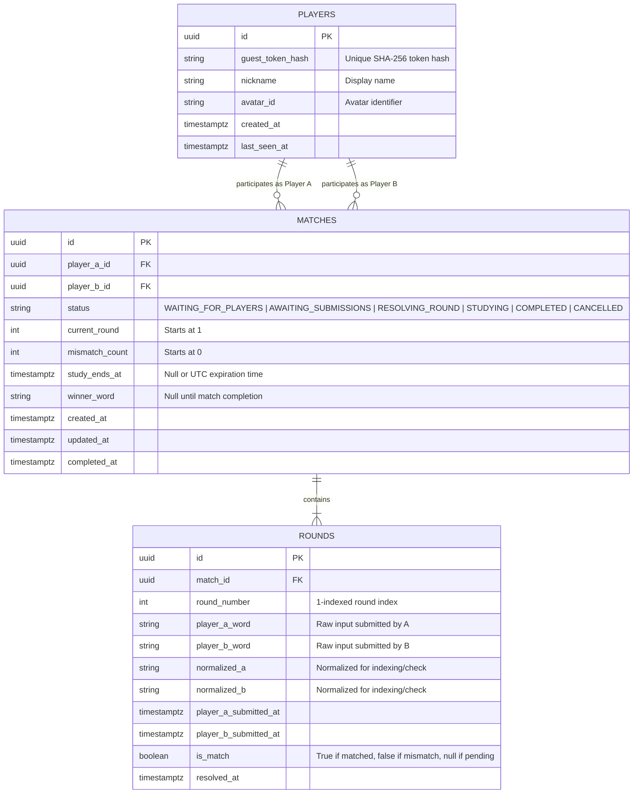

# WordQuest: System Architecture & Data Model

## 1. High-Level Architecture Overview

WordQuest is designed as an event-driven, real-time multiplayer application with a robust transactional relational database layer.

```
┌─────────────────────────────────────────────────────────────┐
│                       Client Layer                          │
│  React (v18+) + Vite + TypeScript                           │
│  - Socket.IO Client (State sync, match events)              │
│  - Reconnection reconciler & client-side study timer        │
└──────────────┬──────────────────────────────▲───────────────┘
               │ HTTP / WebSocket             │
               ▼                              │
┌─────────────────────────────────────────────┴───────────────┐
│                       Server Layer                          │
│  Node.js + Express + Socket.IO + TypeScript                 │
│  - Guest Auth & Session Verifier                            │
│  - Matchmaking Engine (Atomic queue matching)               │
│  - Domain Game Engine (Normalization, Rules, Deadlines)     │
│  - Periodic Sweeper / Cron (Study deadline expirations)     │
└──────────────┬──────────────────────────────▲───────────────┘
               │ Parameterized SQL queries    │
               ▼                              │
┌─────────────────────────────────────────────┴───────────────┐
│                      Database Layer                         │
│  PostgreSQL (Relational persistence)                        │
│  - Players, Matches, Rounds tables                          │
│  - ACID Transactions with Row-Level Locking (FOR UPDATE)    │
│  - Timezone-aware Timestamps (TIMESTAMPTZ)                  │
└─────────────────────────────────────────────────────────────┘
```

---

## 2. Technology Stack & Rationale

| Component | Selected Technology | Architectural Rationale |
| :--- | :--- | :--- |
| **Frontend Framework** | React (Vite) + TypeScript | Fast HMR, strong compile-time types, component modularity. |
| **Realtime Transport**| Socket.IO | Automatic reconnection, room isolation, bidirectional binary/JSON events, fallback to HTTP long-polling. |
| **Backend Runtime** | Node.js + Express + TypeScript | Lightweight asynchronous I/O, shared domain models/types with frontend. |
| **Database** | PostgreSQL | Strong ACID transactions, row-level locks, reliable `TIMESTAMPTZ` support for deadlines. |
| **ORM / Query Layer** | Drizzle ORM | Zero-bloat, direct TypeScript-to-SQL mapping, full control over transactional locking (`FOR UPDATE`), rapid migrations. |
| **Schema Validation** | Zod | Runtime validation for socket payloads, environment variables, and REST APIs. |

---

## 3. Relational Data Model (Schema Design)



### Key Schema Constraints:
- `MATCHES.player_a_id != MATCHES.player_b_id` (Check constraint preventing self-matching).
- `UNIQUE(match_id, round_number)` (Strict integrity: exactly one record per round).
- Indices on `MATCHES(status)`, `MATCHES(player_a_id)`, `MATCHES(player_b_id)`, and `ROUNDS(match_id)`.

---

## 4. Concurrency & Exact-Once Round Resolution

When two players submit words at the exact same time, race conditions could cause double-resolution, duplicate study increments, or corrupted rounds.

### The Locking Pattern:
```sql
-- 1. Begin transaction
BEGIN;

-- 2. Lock the match row so concurrent worker/submission waits
SELECT * FROM matches WHERE id = :matchId FOR UPDATE;

-- 3. Check current state and lock the active round row
SELECT * FROM rounds WHERE match_id = :matchId AND round_number = :roundNumber FOR UPDATE;

-- 4. Record submission for the submitting player
-- If the other player has NOT submitted yet:
UPDATE rounds SET player_a_word = :word, player_a_submitted_at = NOW() WHERE id = :roundId;
COMMIT; -- Release lock, notify room that Player A submitted (without revealing word)

-- If the other player HAS submitted:
UPDATE rounds SET player_b_word = :word, player_b_submitted_at = NOW() WHERE id = :roundId;
-- Compare normalized words
IF normalize(wordA) == normalize(wordB) THEN
    UPDATE matches SET status = 'COMPLETED', winner_word = wordA, completed_at = NOW();
    UPDATE rounds SET is_match = true, resolved_at = NOW();
ELSE
    UPDATE matches SET 
        status = 'STUDYING', 
        mismatch_count = mismatch_count + 1,
        study_ends_at = NOW() + ((mismatch_count + 1) * 15 * INTERVAL '1 minute');
    UPDATE rounds SET is_match = false, resolved_at = NOW();
END IF;

COMMIT;
```

---

## 5. Authoritative Study Timer Management

To ensure reliability across crashes, network dropouts, and restarts:

1. **Dual Validation Pattern**:
   - **Passive Check**: Whenever a player connects, requests state, or attempts an action, the server verifies:
     $$\text{isStudyExpired} = (\text{status} == \text{'STUDYING'}) \land (\text{NOW}() \ge \text{study\_ends\_at})$$
     If expired, the state is transitioned on-the-fly to `AWAITING_SUBMISSIONS` for `current_round + 1`.
   - **Active Sweeper Job**: A lightweight interval (every 10 seconds) queries:
     `SELECT id FROM matches WHERE status = 'STUDYING' AND study_ends_at <= NOW();`
     For each matching record, it safely advances the round and emits `game:study_ended` to the Socket.IO room.
2. **Crash Resilience**: Because `study_ends_at` is stored as an absolute UTC timestamp in PostgreSQL, no timer progress is lost if the backend restarts.

---

## 6. Guest Identity & Authorization Flow

1. On first visit, the client requests a guest identity from `POST /api/auth/guest`.
2. The server generates:
   - A public `playerId` (UUID v4).
   - A cryptographically random `recoveryToken` (64 hex characters from `crypto.randomBytes(32)`).
3. The server computes $\text{SHA-256}(\text{recoveryToken})$ and saves the hash in PostgreSQL.
4. The plain token is sent back to the client once and stored in `localStorage`.
5. On every Socket.IO handshake and REST call, the client passes `Bearer <recoveryToken>`.
6. The server hashes the provided token and verifies ownership. A player cannot view or submit for any match where their `playerId` is not in `(player_a_id, player_b_id)`.
