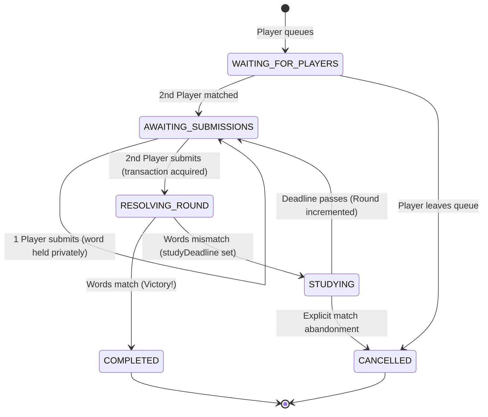

# WordQuest: Gameplay Rules & State Machine Specification

## 1. Core Vision & Gameplay Concept

**WordQuest** is a real-time, 1v1 multiplayer game where two players independently attempt to converge on the exact same word or phrase. 

The mechanics center on:
- **Suspense & Privacy**: Submissions are strictly secret. Neither player can see what the other has entered until both have submitted.
- **Pure Exact Matching**: No AI, embeddings, semantic similarity, or fuzzy synonyms.
- **Progressive Study Delays**: Every mismatch penalizes both players with an incrementally longer study period ($15 \times \text{mismatchCount}$ minutes), forcing patience, deliberate reflection, and shared alignment.
- **Unbroken Shared Session**: Players stay locked into the same match across rounds and study periods until they achieve victory or explicitly abandon.

### 1.1 The Three Core Architectural Anchors
1. **Round History UI Hierarchy**:
   - Words from any round are revealed **only after** that round is resolved.
   - During the study period and subsequent rounds, the **most recent mismatch** is displayed prominently in a dedicated focal card.
   - Older rounds ($R < \text{currentRound} - 1$) are archived into a clean, collapsible history drawer/accordion to maintain focus without visual clutter.
2. **Authoritative PostgreSQL Timer (`study_ends_at`)**:
   - The authoritative deadline is stored as a `TIMESTAMPTZ` column named `study_ends_at` in the PostgreSQL database.
   - Browser countdowns and Node.js in-memory timers are purely reactive UI/notification layers. The database timestamp is the sole source of truth for authorizing round advancement.
3. **True Server-Side Submission Privacy**:
   - Pending words are never passed to the frontend or included in room broadcasts while a round is open.
   - Database queries for state synchronization explicitly mask or omit the pending word of the opponent. Privacy is enforced at the database and API layer, not by CSS `display: none` or React state hiding.

---

## 2. Submission & Normalization Rules

### 2.1 Permitted Inputs
1. Words of **any length** (from short 2-letter words to extended expressions). Fixed 5-letter or Wordle-like constraints are strictly forbidden.
2. Single words and multi-word phrases are both valid (e.g., `sun`, `photosynthesis`, `deep blue sea`).
3. Maximum length: 100 characters (enforced server-side for payload sanity and database hygiene).
4. Printable Unicode / standard alphanumeric characters, spaces, and basic punctuation are allowed. Control characters and HTML/script injection patterns are rejected.

### 2.2 Authoritative Normalization Policy
All comparisons are executed against the normalized string produced by a dedicated backend function (`normalizeWord`).

```typescript
/**
 * Authoritative Word Normalization Function
 * - Trims leading and trailing whitespace.
 * - Collapses internal consecutive whitespace to a single space.
 * - Normalizes to lowercase using standard Unicode case folding.
 * - Does NOT strip internal punctuation, accents, or change spelling.
 */
export function normalizeWord(raw: string): string {
  return raw.trim().replace(/\s+/g, ' ').toLowerCase();
}
```

### 2.3 Equality Comparison
Two submissions $W_A$ and $W_B$ match if and only if:
$$\text{normalizeWord}(W_A) == \text{normalizeWord}(W_B)$$

#### Canonical Examples:
| Player A Input | Player B Input | Normalized A | Normalized B | Result |
| :--- | :--- | :--- | :--- | :--- |
| `"Ocean"` | `"ocean"` | `"ocean"` | `"ocean"` | **MATCH** |
| `"  beautiful "` | `"beautiful"` | `"beautiful"` | `"beautiful"` | **MATCH** |
| `"blue   sky"` | `"blue sky"` | `"blue sky"` | `"blue sky"` | **MATCH** |
| `"river"` | `"rivers"` | `"river"` | `"rivers"` | **MISMATCH** |
| `"sun"` | `"moon"` | `"sun"` | `"moon"` | **MISMATCH** |
| `"café"` | `"cafe"` | `"café"` | `"cafe"` | **MISMATCH** |
| `"it's"` | `"its"` | `"it's"` | `"its"` | **MISMATCH** |

---

## 3. The Progressive Study Timer

### 3.1 Mathematical Rule
The required study duration after round resolution is:
$$\text{studyDurationMinutes} = 15 \times \text{mismatchCount}$$

- **1st Mismatch:** 15 minutes ($15 \times 1$)
- **2nd Mismatch:** 30 minutes ($15 \times 2$)
- **3rd Mismatch:** 45 minutes ($15 \times 3$)
- **4th Mismatch:** 60 minutes ($15 \times 4$)
- **$n$-th Mismatch:** $15 \times n$ minutes

### 3.2 Authoritative Timestamp Architecture
- **Server Authority**: The server calculates the absolute UTC deadline:
  $$\text{studyDeadline} = \text{currentTime} + (\text{studyDurationMinutes} \times 60 \times 1000\text{ ms})$$
- The deadline is persisted in PostgreSQL as a timezone-aware timestamp (`TIMESTAMPTZ`).
- **Client Countdown**: The frontend countdown is an aesthetic convenience. If client clocks are skewed or manipulated, the server rejects any round submission before $\text{serverCurrentTime} \ge \text{studyDeadline}$.
- **Recovery on Restart/Reconnect**: When a client connects or the backend restarts, the remaining time is calculated directly from $(\text{studyDeadline} - \text{NOW()})$.
- **No In-Memory Only Timers**: While a lightweight job runner or setTimeout may wake up to notify active sockets, the database deadline is the definitive state of truth.

---

## 4. Match Lifecycle & State Machine



### 4.1 State Definitions
1. `WAITING_FOR_PLAYERS`: A single player is in the matchmaking queue awaiting an opponent.
2. `AWAITING_SUBMISSIONS`: Both players are paired in a round. Neither, or only one, player has submitted their secret word.
3. `RESOLVING_ROUND`: A transient atomic state executed inside a database transaction when both words have been received. Both words are compared.
4. `STUDYING`: The words did not match. `mismatchCount` is incremented by 1, `studyDeadline` is set, and previous words are permanently revealed in history. Submissions for the next round are locked.
5. `COMPLETED`: The words matched. The match concludes in mutual victory. Both words are revealed.
6. `CANCELLED`: The match was abandoned according to explicit abandonment rules or administrative action.

---

## 5. Concurrency & Synchronization Guarantees

1. **Simultaneous Submissions**: If both players hit "Submit" within milliseconds of each other:
   - Database row-level locking (`SELECT ... FOR UPDATE` on the match record) ensures that round resolution occurs **exactly once**.
   - No duplicate rounds can be created.
   - The mismatch counter increments **exactly once**.
2. **Idempotency**: Retrying a submission with an identical round number and player ID returns the existing status without error or duplicate records.
3. **Privacy Invariant**: Under no circumstance is Player A's submission broadcast or sent to Player B's client while state is `AWAITING_SUBMISSIONS`. Player B's client only receives an event stating: `{ status: "OPPONENT_SUBMITTED" }`.
